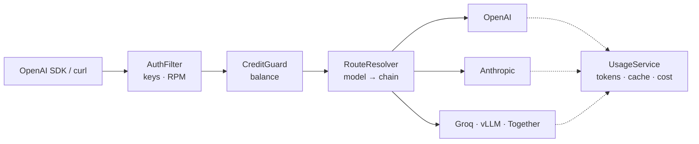

# Path

[](https://github.com/an1ndra/path/actions/workflows/ci.yml)
[](https://github.com/an1ndra/path/actions/workflows/release.yml)
[](https://www.gnu.org/licenses/gpl-3.0)

A provider-agnostic LLM gateway. One HTTP surface in front of every provider you use —
OpenAI, Anthropic, Groq, and anything OpenAI-compatible — with model routing, automatic
fallback, per-key credits and cache-aware token metering. Spring Boot 3.5, Java 21.

Clients speak the OpenAI chat-completions shape because that is what most SDKs already
implement. The gateway translates to each provider's native protocol, so adding or
swapping a provider never changes client code.



## What it does

- **One surface, many providers** — OpenAI, Anthropic, Groq and any OpenAI-compatible
  endpoint, including streaming and tool calls.
- **Routing and fallback** — a model id maps to an ordered chain; 429/5xx/timeouts fall
  through, with capability aliases (`cheap`, `fast`, `long-context`) and weighted canary
  splits.
- **Keys, budgets and limits** — `sk-gw-...` keys with lifetime/daily/monthly budgets,
  per-key model allowlists, RPM and in-flight caps.
- **Cache-aware metering** — prompt, completion, cached and reasoning tokens, itemised
  cost, TTFT and throughput per call.
- **Operable** — Flyway migrations, health/readiness, Prometheus metrics, tracing,
  structured logs, an admin audit trail and an OpenAPI spec.

## Quick start

```bash
export OPENAI_API_KEY=sk-...            # any subset works
export ANTHROPIC_API_KEY=sk-ant-...
export GROQ_API_KEY=gsk_...
export GATEWAY_ADMIN_TOKEN=pick-something-long

./mvnw spring-boot:run
```

First boot seeds three providers, a route table and one demo key, printed in the log:

```
Created demo API key (no credit limit): sk-gw-...
```

```bash
KEY=sk-gw-...

curl -s http://localhost:8080/v1/chat/completions \
  -H "Authorization: Bearer $KEY" -H 'Content-Type: application/json' \
  -d '{"model":"auto-fast","messages":[{"role":"user","content":"Say hi"}]}'
```

Any OpenAI SDK works — point `base_url` at `http://localhost:8080/v1`:

```python
from openai import OpenAI
client = OpenAI(base_url="http://localhost:8080/v1", api_key="sk-gw-...")
print(client.chat.completions.create(
    model="cheap",
    messages=[{"role": "user", "content": "hello"}],
).choices[0].message.content)
```

## Documentation

| Document | Contents |
|---|---|
| [API reference](docs/API.md) | Every endpoint, request/response shapes, error codes, idempotency, cache, embeddings |
| [Architecture](docs/ARCHITECTURE.md) | Request flow, providers, routing, what is metered |
| [Configuration](docs/CONFIGURATION.md) | Every environment variable, timeouts, credentials, Postgres |
| [Operations](docs/OPERATIONS.md) | Admin API, metrics, tracing, migrations, alerts, load testing |
| [Limits](docs/LIMITS.md) | Design decisions and known gaps |
| [Testing](docs/TESTING.md) | Unit tests, the 99-check smoke suite, the mock upstream |
| [AGENTS.md](AGENTS.md) | Contributor conventions and gotchas |
| [Postman](docs/path.postman_collection.json) | 26 requests over the public and admin surfaces |

## License

GNU General Public License v3.0 — see [LICENSE](LICENSE). Copyright (C) 2026 Anindra.
