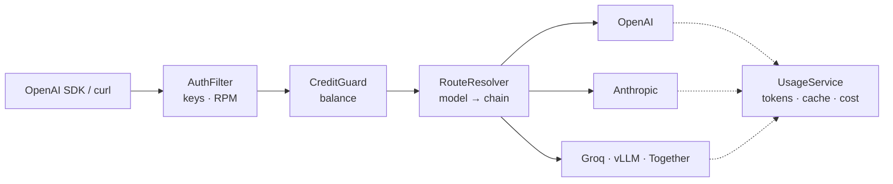

# Path

[](https://github.com/an1ndra/path/actions/workflows/ci.yml)
[](https://github.com/an1ndra/path/actions/workflows/release.yml)
[](https://www.gnu.org/licenses/gpl-3.0)

A provider-agnostic LLM gateway. One HTTP surface in front of every provider you use —
OpenAI, Anthropic, Groq, and anything OpenAI-compatible — with model routing, automatic
fallback, per-key credits, rate limits and cache-aware token metering. Spring Boot 3.5,
Java 21, H2 by default (Postgres ready).

Clients speak the OpenAI chat-completions shape because that is what most SDKs,
frameworks and CLI tools already implement. The gateway translates to each provider's
native protocol, so adding or swapping a provider never changes client code.

## Documentation

- [API reference](docs/API.md) — every endpoint with request/response shapes, error
  codes and metering fields.
- [Postman collection](docs/path.postman_collection.json) and
  [environment](docs/path.postman_environment.json) — 26 requests over the public and
  admin surfaces. Import both, then run **00 · Setup** to mint a key.
- [AGENTS.md](AGENTS.md) — architecture, conventions and gotchas for contributors.



Every request enters through one OpenAI-compatible surface, is authenticated and
authorised, then routed to the highest-priority provider that can serve it; the
response is metered on the way back.

## What it does

- **One surface, many providers.** OpenAI, Anthropic, Groq and any OpenAI-compatible
  endpoint behind a single API. Anthropic's Messages API is translated in both
  directions, including streaming and tool calls. Adding a provider is a database row,
  not a client change.
- **Routing.** A public model id (e.g. `gpt-4o-mini`, `auto-fast`) maps to one or more
  ordered routes. Lower `priority` wins.
- **Fallback.** 429 / 408 / 5xx / timeouts fall through to the next route. Streaming
  falls back only before the first chunk; afterwards the client is committed.
- **Clients and credits.** Issue `sk-gw-...` keys, set a USD credit limit and an RPM
  limit, watch `used_usd` grow as requests are metered by token price.
- **Metering.** Every call is recorded with model, provider, tokens, cost, latency and
  status. Percentiles and per-provider/model breakdowns via `/admin/stats`.
- **Model catalogue.** `/v1/models` exposes every enabled route with providers and
  pricing; `/admin/models/sync` imports each provider's real model list.

## What is metered

Every call records the full token picture both providers report, not just totals:

| Field | Source (OpenAI / Anthropic) |
|---|---|
| `prompt_tokens` | `usage.prompt_tokens` / `input_tokens` + cache read + cache write |
| `completion_tokens` | `usage.completion_tokens` / `output_tokens` (includes thinking) |
| `cached_input_tokens` | `prompt_tokens_details.cached_tokens` / `cache_read_input_tokens` |
| `cache_write_tokens` | — / `cache_creation_input_tokens` |
| `reasoning_tokens` | `completion_tokens_details.reasoning_tokens` / in `output_tokens` |
| `audio_input/output_tokens` | `*_tokens_details.audio_tokens` / — |

Cost is stored itemised — `input_cost_usd`, `cached_input_cost_usd`,
`cache_write_cost_usd`, `output_cost_usd`, `cost_usd` — plus
`cached_savings_usd` (what the cached tokens would have cost at the full input rate).
Cached tokens are billed at their own rate when the route has one, otherwise at the
plain input rate; Anthropic cache writes are billed at their premium rate.

Also captured per call: `ttft_ms` and `tokens_per_second` (streaming),
`upstream_request_id`, `finish_reason`, `attempts`, `fallback_from`, and
`usage_estimated` — true when the provider returned no usage block and the counts were
inferred from text length rather than observed.

Aggregates: `/v1/usage` adds cache hit ratio and savings for the calling key;
`/admin/stats` adds cache hit ratio and savings, p50/p95 TTFT, median throughput,
fallback count and estimated-usage count.

## Providers

Two wire formats cover every provider worth proxying:

| Type | Speaks | Works with |
|---|---|---|
| `OPENAI` | chat-completions | OpenAI, Groq, Together, Fireworks, DeepSeek, vLLM, LM Studio, Ollama's `/v1`, any compatible endpoint |
| `ANTHROPIC` | Messages API | Anthropic (native, with prompt caching and tool calls) |

Any other provider is a normalised capability, not a code change: register it with
`POST /admin/providers`, give it a base URL and a wire type, then add routes. A new
wire format would mean implementing `ProviderAdapter` (~200 lines for an
OpenAI-shaped API, ~400 for Anthropic).

## Quick start

```bash
cd ai-gateway
export OPENAI_API_KEY=sk-...          # any subset works
export ANTHROPIC_API_KEY=sk-ant-...
export GROQ_API_KEY=gsk_...
export GATEWAY_ADMIN_TOKEN=pick-something-long

./mvnw spring-boot:run
```

On first boot the seeder creates three providers, a starter route table and one demo
client key, printed in the log:

```
Created demo API key (no credit limit): sk-gw-...
```

Send a request:

```bash
KEY=sk-gw-...

# non-streaming
curl -s http://localhost:8080/v1/chat/completions \
  -H "Authorization: Bearer $KEY" -H 'Content-Type: application/json' \
  -d '{"model":"gpt-4o-mini","messages":[{"role":"user","content":"Say hi"}]}'

# streaming
curl -N http://localhost:8080/v1/chat/completions \
  -H "Authorization: Bearer $KEY" -H 'Content-Type: application/json' \
  -d '{"model":"claude-3.5-haiku","stream":true,
       "stream_options":{"include_usage":true},
       "messages":[{"role":"user","content":"Say hi"}]}'
```

Non-streaming responses carry `X-Gateway-Provider`, `X-Gateway-Upstream-Model`,
`X-Gateway-Cost-Usd` and `X-Gateway-Latency-Ms`.

Any OpenAI SDK works — set `base_url` to `http://localhost:8080/v1` and the key above:

```python
from openai import OpenAI
client = OpenAI(base_url="http://localhost:8080/v1", api_key="sk-gw-...")
print(client.chat.completions.create(
    model="auto-fast",
    messages=[{"role": "user", "content": "hello"}],
).choices[0].message.content)
```

## Routing

Routes are rows of `(public_model_id, provider, upstream_model_id, priority, price)`.

`auto-fast` in the seed data has two routes, which gives a cross-provider fallback:

| public id | provider | upstream | priority |
|---|---|---|---|
| auto-fast | openai | gpt-4o-mini | 1 |
| auto-fast | groq | llama-3.3-70b-versatile | 2 |

Request-level controls, OpenRouter style:

```jsonc
{
  "model": "gpt-4o-mini",
  "models": ["gpt-4o-mini", "claude-3.5-haiku"],   // extra fallback models, in order
  "provider": {"order": ["groq", "openai"], "allow_fallbacks": false},
  "messages": [...]
}
```

`provider.allow_fallbacks: false` pins the request to the first route, so an upstream
500 surfaces to the caller instead of being masked.

## Admin API

Every `/admin/**` call needs `X-Admin-Token: $GATEWAY_ADMIN_TOKEN`. If that variable is
empty the admin API is disabled (403).

```bash
A='X-Admin-Token: pick-something-long'

# providers
curl -s localhost:8080/admin/providers -H "$A"
curl -s -X PATCH localhost:8080/admin/providers/1 -H "$A" -H 'Content-Type: application/json' \
  -d '{"base_url":"https://api.openai.com/v1","api_key":"sk-..."}'
curl -s -X POST localhost:8080/admin/providers -H "$A" -H 'Content-Type: application/json' \
  -d '{"slug":"together","display_name":"Together","type":"OPENAI",
       "base_url":"https://api.together.xyz/v1","api_key":"..."}'

# routes
curl -s -X POST localhost:8080/admin/routes -H "$A" -H 'Content-Type: application/json' \
  -d '{"public_model_id":"gpt-4o-mini","provider_id":1,"upstream_model_id":"gpt-4o-mini",
       "input_price_per_million":0.15,"output_price_per_million":0.60,"priority":10}'

# client keys — the plaintext is returned exactly once
curl -s -X POST localhost:8080/admin/keys -H "$A" -H 'Content-Type: application/json' \
  -d '{"name":"team-a","credit_limit_usd":25,"rpm_limit":120}'
curl -s -X POST localhost:8080/admin/keys/1/topup -H "$A" -H 'Content-Type: application/json' \
  -d '{"amount_usd":10}'
curl -s -X POST localhost:8080/admin/keys/1/revoke -H "$A"

# import each provider's model list (built-in prices for well-known ids, 0.00 otherwise)
curl -s -X POST localhost:8080/admin/models/sync -H "$A"

# reporting
curl -s 'localhost:8080/admin/stats?window=24h' -H "$A"
curl -s 'localhost:8080/admin/usage?window=7d&limit=50' -H "$A"
```

Admin JSON accepts snake_case (`credit_limit_usd`) and camelCase (`creditLimitUsd`).

## Public endpoints

| Method | Path | Auth | Purpose |
|---|---|---|---|
| POST | `/v1/chat/completions` | bearer key | chat, `stream: true` for SSE |
| GET | `/v1/models` | none if `gateway.public-models=true` | catalogue |
| GET | `/v1/models/{id}` | same | one model |
| GET | `/v1/usage?window=24h` | bearer key | this key's tokens, spend, recent calls |
| GET | `/v1/credits` | bearer key | limit, used, remaining |
| GET | `/actuator/health` | none | liveness |

Errors use the OpenAI envelope:

```json
{"error": {"message": "...", "type": "invalid_request_error", "code": "model_not_found"}}
```

Codes include `missing_api_key`, `invalid_api_key`, `key_disabled`,
`model_not_found`, `insufficient_credits`, `rate_limit_exceeded`,
`upstream_timeout`, `upstream_error`, `provider_auth_error`, `all_providers_failed`,
`circuit_open`, `idempotency_conflict`, `idempotency_in_progress`.

## Configuration

| Variable | Default | Meaning |
|---|---|---|
| `PORT` | `8080` | HTTP port |
| `GATEWAY_ADMIN_TOKEN` | empty (admin off) | admin shared secret |
| `GATEWAY_PUBLIC_MODELS` | `true` | allow keyless `/v1/models` |
| `GATEWAY_CORS_ORIGINS` | `*` | comma-separated origin patterns |
| `GATEWAY_MASTER_KEY` | generated | base64 32-byte AES key for stored credentials |
| `GATEWAY_MASTER_KEY_PATH` | `./data/master.key` | where the generated key is kept (0600) |
| `GATEWAY_BOOTSTRAP_DEMO_KEY` | `true` | create a demo key when the table is empty |
| `GATEWAY_DEFAULT_RPM` | `120` | default requests/minute for new keys |
| `GATEWAY_DEFAULT_CREDIT_USD` | unlimited | default credit limit for new keys |
| `GATEWAY_BREAKER_FAILURES` | `5` | consecutive upstream failures before a provider is parked |
| `GATEWAY_BREAKER_OPEN` | `30s` | how long a parked provider is skipped |
| `GATEWAY_MAX_ATTEMPTS` | `3` | routes tried per request, including the first |
| `GATEWAY_IDEMPOTENCY_TTL` | `24h` | how long a completed response stays replayable |
| `GATEWAY_IDEMPOTENCY_MAX_BYTES` | `2097152` | responses larger than this are not stored for replay |
| `OPENAI_API_KEY` / `ANTHROPIC_API_KEY` / `GROQ_API_KEY` | — | upstream credentials |
| `GATEWAY_UPSTREAM_<SLUG>_KEY` | — | credential for any other provider slug |
| `DB_URL`, `DB_USER`, `DB_PASSWORD` | H2 file | database |

Timeouts live in `application.yml` under `gateway.*`: `connect-timeout` (10s),
`request-timeout` (180s), `stream-idle-timeout` (120s).

Credentials stored through the admin API are AES-GCM encrypted; the environment
variables are never written to disk.

## Postgres

```bash
export SPRING_PROFILES_ACTIVE=postgres
export DB_URL=jdbc:postgresql://localhost:5432/aigateway
export DB_USER=aigateway DB_PASSWORD=aigateway
./mvnw spring-boot:run
```

or `docker compose up --build`.

## Tests

```bash
./mvnw test                       # 11 tests: API surface, auth, credits, Anthropic translation
```

End-to-end against a mock upstream (no real keys needed, exercises both wire formats,
streaming, fallback, 402/429, metering and sync):

```bash
python3 tools/mock-upstream.py 9099 &
GATEWAY_ADMIN_TOKEN=test-admin java -jar target/path-0.1.0.jar &
python3 tools/smoke_test.py        # 49 checks
```

## Design notes and limits

- **Idempotency is opt-in per request.** Send `Idempotency-Key` and a repeat of the
  same request replays the stored response (streams included) with
  `X-Idempotent-Replay: true`; a different body under the same key gets 409
  `idempotency_conflict`, and a concurrent duplicate gets 409
  `idempotency_in_progress`. Completed responses are kept for
  `GATEWAY_IDEMPOTENCY_TTL`. A response larger than
  `GATEWAY_IDEMPOTENCY_MAX_BYTES` is not stored, so a retry calls the provider again.
- **Circuit breaker per provider.** Five consecutive failures park a provider for 30s
  (both configurable); routes on a parked provider are skipped in microseconds instead
  of costing a connect timeout. An upstream 429 with `Retry-After` parks the provider
  for exactly that long. State is visible as `circuit_state` on `/admin/providers`.
- **Rate limiting is in-memory, one node.** It is exact on a single instance and
  approximate across a cluster. Move the map in `RateLimiter` to Redis for multi-node.
- **Credits are charged after the call** from reported token usage, with a worst-case
  estimate checked before it. An upstream that reports no usage is billed from an
  estimate and flagged with `usage_estimated=true`, so inferred spend is never
  presented as observed.
- **Cost precision is 8 decimals.** Each component is rounded before summing, so a
  call's stored total can differ from the exact product by at most one unit in the
  eighth decimal (USD 1e-8).
- **Streaming has no resume.** Once bytes are sent the route cannot change; failures
  arrive as an SSE error object followed by `data: [DONE]`.
- **Chat only.** Like OpenRouter, this gateway does not proxy embeddings/images/audio;
  the adapters are written around chat-completions.
- **Anthropic tool translation** covers text, images (base64 and URL), tools,
  tool results, `tool_choice` and `parallel_tool_calls`. Anthropic-specific betas,
  prompt caching and extended thinking blocks are not forwarded.
- **Model sync** filters out non-chat ids (embeddings, TTS, whisper, image models)
  and prices only the ids listed in `ModelSyncService.PRICES`; everything else lands
  at 0.00 until edited.

## License

Copyright (C) 2026 Anindra

Path is free software: you can redistribute it and/or modify it under the terms of the
GNU General Public License as published by the Free Software Foundation, either
version 3 of the License, or (at your option) any later version.

Path is distributed in the hope that it will be useful, but WITHOUT ANY WARRANTY;
without even the implied warranty of MERCHANTABILITY or FITNESS FOR A PARTICULAR
PURPOSE. See the GNU General Public License for more details.

You should have received a copy of the [GNU General Public License](LICENSE) along with
this program. If not, see <https://www.gnu.org/licenses/>.
