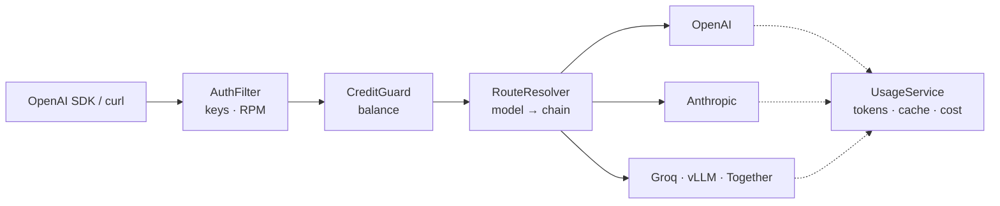

# Path

[](https://github.com/an1ndra/path/actions/workflows/ci.yml)
[](https://github.com/an1ndra/path/actions/workflows/release.yml)
[](https://www.gnu.org/licenses/gpl-3.0)

**The LLM gateway for teams that run Java.** A provider-agnostic gateway — one HTTP
surface in front of OpenAI, Anthropic, Groq, Google Gemini and anything
OpenAI-compatible — with model routing, automatic fallback, per-key credits and
cache-aware token metering. Spring Boot 3.5, Java 21, one process to operate.

New here? [Why Path](docs/WHY-PATH.md) compares it honestly with LiteLLM, Portkey and
OpenRouter, including where it loses.

Clients speak the OpenAI chat-completions shape because that is what most SDKs already
implement. The gateway translates to each provider's native protocol, so adding or
swapping a provider never changes client code.



## What it does

- **One surface, many providers** — OpenAI, Anthropic, Groq, Google Gemini and any
  OpenAI-compatible endpoint, including streaming and tool calls.
- **Routing and fallback** — a model id maps to an ordered chain; 429/5xx/timeouts fall
  through, with capability aliases (`cheap`, `fast`, `long-context`) and weighted canary
  splits.
- **Keys, budgets and limits** — `sk-gw-...` keys with lifetime/daily/monthly budgets,
  per-key model allowlists, RPM and in-flight caps; projects and scoped admin tokens for
  teams.
- **Cache-aware metering** — prompt, completion, cached and reasoning tokens, itemised
  cost, TTFT and throughput per call.
- **Operable** — Flyway migrations, health/readiness, Prometheus metrics, tracing,
  structured logs, an admin audit trail and an OpenAPI spec.

## Install on Kubernetes

```bash
helm install path deploy/helm/path --namespace path --create-namespace \
  --set existingSecret=path-credentials
```

The chart refuses to render when `terminationGracePeriodSeconds` is not above
`GATEWAY_DRAIN_TIMEOUT`, because that combination truncates live SSE streams on a
rolling update. See [deploy/helm/path/README.md](deploy/helm/path/README.md) for the rest.

## Quick start

```bash
export OPENAI_API_KEY=sk-...            # any subset works
export ANTHROPIC_API_KEY=sk-ant-...
export GROQ_API_KEY=gsk_...
export GATEWAY_ADMIN_TOKEN=pick-something-long

./mvnw -pl path-gateway spring-boot:run
```

First boot seeds four providers and a starter route table. To also mint a demo key
(off by default, never in the `prod` profile), start with
`GATEWAY_BOOTSTRAP_DEMO_KEY=true`; it is printed once in the log:

```
Created demo API key (no credit limit): sk-gw-...
```

```bash
KEY=sk-gw-...

curl -s http://localhost:8080/v1/chat/completions \
  -H "Authorization: Bearer $KEY" -H 'Content-Type: application/json' \
  -d '{"model":"auto-fast","messages":[{"role":"user","content":"Say hi"}]}'
```

Any OpenAI SDK works — point `base_url` at `http://localhost:8080/v1`:

```python
from openai import OpenAI
client = OpenAI(base_url="http://localhost:8080/v1", api_key="sk-gw-...")
print(client.chat.completions.create(
    model="cheap",
    messages=[{"role": "user", "content": "hello"}],
).choices[0].message.content)
```

## Documentation

| Document | Contents |
|---|---|
| [Spring AI adapter](docs/SPRING-AI.md) | `path-spring-ai`: ChatModel and EmbeddingModel over the gateway |
| [API reference](docs/API.md) | Every endpoint, request/response shapes, error codes, idempotency, cache, embeddings |
| [Architecture](docs/ARCHITECTURE.md) | Request flow, providers, routing, what is metered |
| [Configuration](docs/CONFIGURATION.md) | Every environment variable, timeouts, credentials, Postgres |
| [Operations](docs/OPERATIONS.md) | Admin API, metrics, tracing, migrations, alerts, load testing |
| [Limits](docs/LIMITS.md) | Design decisions and known gaps |
| [Testing](docs/TESTING.md) | Unit tests, the 99-check smoke suite, the mock upstream |
| [Why Path](docs/WHY-PATH.md) | Honest comparison and a 60-second demo |
| [SSO and 2FA](docs/SSO.md) | Google/GitHub/enterprise SSO, passkeys and 2FA via an authenticating proxy |
| [Admin UI](docs/ADMIN-UI.md) | The web console lives in `an1ndra/path-admin`; auth, hosting and CORS |
| [Deploy on Dokploy](deploy/dokploy/README.md) | Two apps, compose or plain application, health checks, CORS |
| [Publishing](docs/PUBLISHING.md) | Maven Central setup, signing and the release profile |
| [Roadmap](docs/ROADMAP.md) | Delivered work and the open stories |
| [Changelog](CHANGELOG.md) | Release notes, also used as the GitHub release body |
| [Security policy](SECURITY.md) | How to report a vulnerability and what CI checks |
| [AGENTS.md](AGENTS.md) | Contributor conventions and gotchas |
| [Postman](docs/path.postman_collection.json) | 26 requests over the public and admin surfaces |
| [Bruno](bruno/README.md) | the same 26 requests as git-friendly `.bru` files |

## License

GNU General Public License v3.0 — see [LICENSE](LICENSE). Copyright (C) 2026 Anindra.
